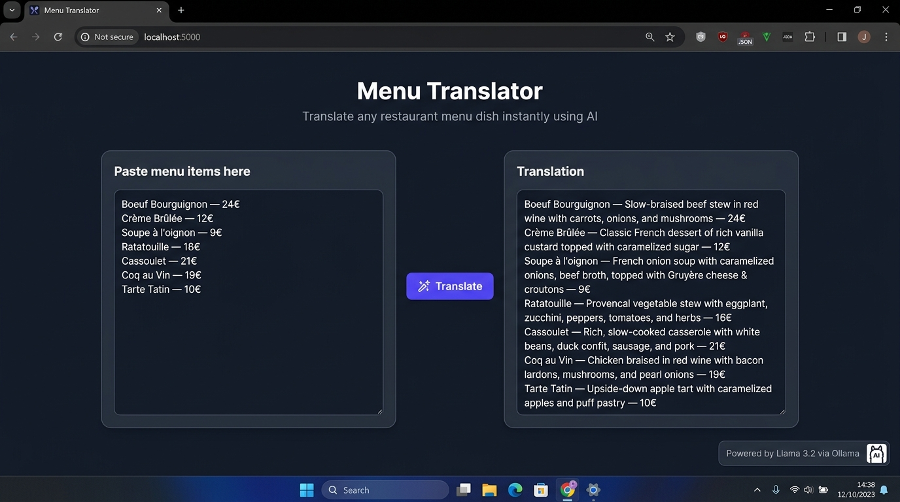

# Menu Translator

Translates restaurant menu dishes using a local open-source model (Llama 3.2 via Ollama). Runs offline, no API cost, menu data stays private.

## Screenshot

## Safety

This tool is designed to reduce allergen misinformation in translated menus:

- The model **only states ingredients explicitly written** in the restaurant notes you provide. For dishes not covered by the notes, it **never lists ingredients** — it only describes what kind of dish it is.
- The model **never claims a dish is allergen-free** (e.g. "peanut-free", "gluten-free", "vegan") unless the notes explicitly say so.
- Dishes without notes are marked with **(ingredients and allergens not confirmed, owner please verify)**.
- A visible warning reminds users to review all output before printing.
- Supports **18 languages** including English, Hindi, Spanish, French, German, Italian, Japanese, Korean, Arabic, and more.

> **Always review translations with your chef or menu owner before publishing.**

## Setup
1. Install Ollama from ollama.com
2. ollama pull llama3.2
3. pip install -r requirements.txt
4. python app.py
5. Open http://localhost:5000